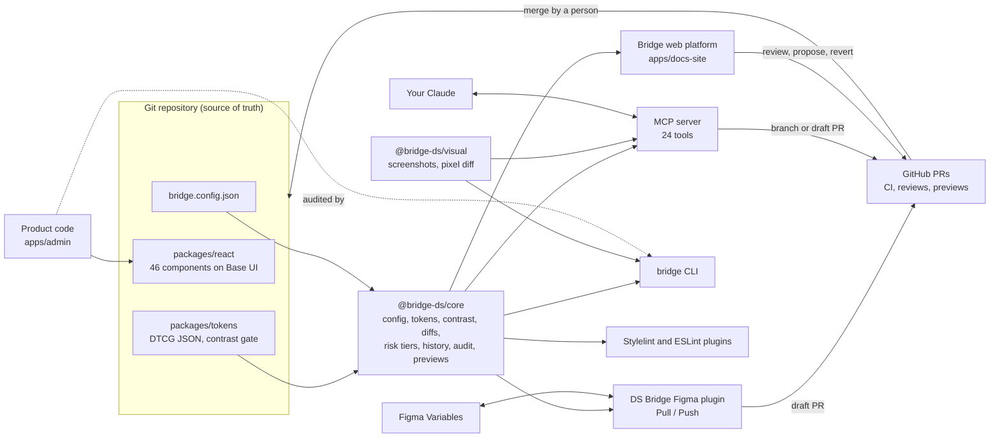

# Bridge

**Bridge is a free, open-source design system as code.** Tokens and components live in this repository and are
the source of truth. Figma, your AI assistant and your product teams all read from it and propose changes back
to it as pull requests that people review.

- **Tokens**: W3C DTCG 2025.10 in tiers (primitives, brands, semantic, density, component), two brands
  (`bridge`, `ocean`), light and dark themes, comfortable and compact density, built by Style Dictionary with a
  WCAG contrast gate (220 pairs checked in every brand and theme).
- **46 React components** on [Base UI](https://base-ui.com) for behavior and accessibility, styled with CSS
  Modules that only read tokens. Keyboard, ARIA and axe-core tests; an "All states" story for each.
- **Bridge web platform** (`apps/docs-site`): token explorer, foundations, component docs with a props
  playground, theme playground, and the process pages: Reviews, History, Branches, Adoption, Governance, Changelog.
- **DS Bridge Figma plugin** (`apps/figma-plugin`): **Pull** tokens into Figma Variables, **Push** variable edits
  back as a draft pull request with a three-way diff and the contrast gate. Free Figma plan, Plugin API only.
- **MCP server and CLI for your own Claude**: 21 MCP tools and the `bridge` command. Claude reads tokens and
  components, checks contrast, proposes changes on a branch or a draft PR, reviews PRs, audits product code.
  It never writes to `main`.
- **Reviews**: token PRs reviewed from Bridge with a diff table, contrast before and after, downstream impact,
  risk tier, CI status and approvals.
- **History and revert**: every merged token change with who, when, why and the version it shipped in; a revert
  planner that shows conflicts with later changes instead of a blind `git revert`.
- **Visual impact**: `bridge impact` screenshots the stories and app screens a change touches at both refs and
  pixel-diffs them. On PRs, a sticky comment and a before/after slider in Reviews.
- **Adoption audit**: `bridge audit <path>` measures token and component adoption in product code, lists
  hardcoded values with the closest token and foreign components with the DS one to use. Stylelint and ESLint
  plugins give the same feedback in the editor.
- **Branch previews**: every PR publishes snapshot packages and per-branch deploys of the docs, Storybook and the
  admin demo, listed on the Branches page. A product staging can preview a branch's tokens without reinstalling.

Maintained by Florian Gouloubi. Licensed MIT.

## Live

| App | URL | What it is |
| --- | --- | --- |
| Bridge | <https://bridge.floriangouloubi.com> | Docs and Studio: token explorer, component docs, Reviews, History, Branches |
| Admin demo | <https://bridge-demo.floriangouloubi.com> | The react-admin e-commerce back office, migrated from MUI to Bridge |
| Storybook | <https://bridge-storybook.floriangouloubi.com> | Component workbench and visual test fixtures |

All three deploy from `main` on Vercel. Every pull request also gets a per-branch deploy of each, linked in the PR
comment and on the [Branches](https://bridge.floriangouloubi.com/studio/branches/) page.

## Status

Working and tested end to end in this repository, **not published yet**. The packages are ready for npm under
the `@bridge-ds` scope (`npm run build:packages` builds and checks every `dist/`), and the release workflow is
inert until an `NPM_TOKEN` secret exists. Until then, use Bridge from a clone. The apps above and their branch
previews run on Vercel; snapshot packages need the pkg.pr.new setup in [`docs/PREVIEWS.md`](docs/PREVIEWS.md).

## Quickstart

Requires Node 20.19+ (see `.nvmrc`).

```sh
git clone https://github.com/peterbono/ai-design-system-demo.git bridge && cd bridge
npm install
npm run docs:dev          # Bridge web platform on http://localhost:4321
npm run storybook         # component workbench on http://localhost:6006
npm run admin:dev         # the back-office demo built on Bridge
```

Connect your Claude (Claude Code shown; Claude Desktop and other MCP clients in [`docs/AI.md`](docs/AI.md)):

```sh
npm run mcp:build
claude mcp add bridge -- node "$PWD/packages/mcp/dist/index.js" --root "$PWD"
```

Then ask: "Which token should I use for danger text?", "Darken muted text in light and show me the contrast
impact first", "Audit apps/admin/src for hardcoded values", "Undo PR 12, but show me what changed since".

The CLI does the same from a terminal or CI:

```sh
npm run bridge -- check                       # config, token validation, contrast gate
npm run bridge -- audit apps/admin/src        # adoption in product code
npm run bridge -- history color.text.muted    # every change of one token
npm run bridge -- impact --plan               # what a change would capture, in seconds
```

### Use the components in an app

```tsx
import '@bridge-ds/tokens/fonts.css';   // IBM Plex Sans + Mono, self-hosted
import '@bridge-ds/tokens/tokens.css';  // every token as a CSS variable
import '@bridge-ds/react/styles.css';   // base styles

import { Button, Field, Input, ThemeProvider } from '@bridge-ds/react';

export function App() {
  return (
    <ThemeProvider asRoot theme="light" brand="bridge" density="comfortable">
      <Field label="Repository" description="Owner and name, like acme/design-tokens.">
        <Input placeholder="acme/design-tokens" />
      </Field>
      <Button>Connect repository</Button>
    </ThemeProvider>
  );
}
```

`ThemeProvider` sets `data-theme`, `data-brand` and `data-density` together and passes them to portaled overlays.
Without React, set the three attributes yourself.

## Architecture



Everything reads one `bridge.config.json` (schema: `packages/core/bridge.config.schema.json`). Nothing writes to
`main`: Figma pushes, Claude's proposals, token edits from the web platform and reverts all arrive as branches or
draft pull requests, and go through the same CI and review.

## Repository map

```
packages/tokens           DTCG tokens, Style Dictionary build, contrast gate
packages/react            46 components: Base UI, CSS Modules on tokens, stories, docs.json, tests
packages/core             shared logic: config, token loading, contrast, diffs, edits, risk tiers, GitHub client,
                          history and revert planner, usage index, adoption audit, previews
packages/visual           visual impact: selection, deterministic capture, pixel diff, manifest
packages/mcp              MCP server (stdio), 24 tools, resources and prompts
packages/cli              bridge CLI: init, check, tokens, diff, propose, history, revert, impact, audit, mcp
packages/stylelint-plugin bridge/use-tokens for product CSS
packages/eslint-plugin    bridge/no-hardcoded-style-values and bridge/prefer-ds-components
apps/docs-site            Bridge web platform (Astro), generated from the repo
apps/figma-plugin         DS Bridge Figma plugin
apps/admin                back-office demo: the react-admin e-commerce demo migrated from MUI to Bridge
apps/admin/_original      the untouched react-admin demo source, the "before" of the adoption audit
docs/                     AI.md (MCP and CLI), PREVIEWS.md, GOVERNANCE.md, DESIGN-LANGUAGE.md, ARCHITECTURE.md
scripts/                  build-packages, rename-scope, vercel-ignore
.github/workflows         ci, visual-impact, preview-packages, release
AGENTS.md                 rules and component checklist for AI agents (CLAUDE.md imports it)
```

## Checks

CI runs the same commands you can run locally:

```sh
npm run tokens:build      # DTCG to CSS variables and TS, fails on contrast
npm run typecheck         # every package and app, strict
npm run lint:css          # tokens only in component and docs CSS (admin: npm run admin:lint:css)
npm test                  # Vitest: components (jsdom, axe-core), core, docs, admin, visual, lint plugins
npm run mcp:test          # MCP server and CLI, including a stdio smoke test
npm run plugin:test       # Figma plugin flows against a fake GitHub
npm run build-storybook   # must build with no errors
npm run docs:build        # the web platform
npm run build:packages    # publishable dist/ for every @bridge-ds package
node scripts/rename-scope.mjs --check   # only @bridge-ds package names
```

## How changes flow

- **The repo is the source of truth.** Figma explores; tokens decide. Figma edits come back as reviewed PRs.
- **Guardrails live in CI, not in prompts.** Stylelint rejects raw values, the token build rejects contrast
  failures, tests check keyboard and ARIA. An agent cannot talk its way past a failing check.
- **Agents are contributors, not maintainers.** They work on branches, add a changeset, fill the PR template and
  never merge (`AGENTS.md`).
- **Review effort scales with risk.** Docs fixes are Tier 1, new variants Tier 2, token and breaking changes
  Tier 3 with design and tech owner approval (`docs/GOVERNANCE.md`).

## Credits

`apps/admin` starts from the [react-admin e-commerce demo](https://github.com/marmelab/react-admin/tree/master/examples/demo)
by Marmelab (MIT, see `apps/admin/_original/LICENSE`). The original source is kept in `apps/admin/_original` as the
baseline of the adoption audit; the migrated app keeps react-admin's headless `ra-core` and replaces MUI with
Bridge components. Component behavior comes from [Base UI](https://base-ui.com), icons from
[Lucide](https://lucide.dev), type from IBM Plex.

## License

MIT, Copyright (c) 2026 Florian Gouloubi. See [`LICENSE`](LICENSE). Third-party code keeps its own license
(`apps/admin/_original/LICENSE`).
