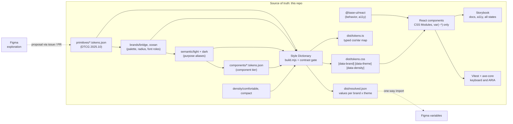

# Architecture

## Pipeline



Plain-text version:

```
primitives --> brands (palette roles) --> semantic light/dark --> component tier
                                                   density --/
all of it --> Style Dictionary (build.mjs) --> tokens.css + tokens.ts + resolved.json, fails on contrast
@base-ui/react (behavior) + tokens.css (look) --> @demo-ds/react components --> Storybook, Vitest

Figma (explore) ..proposal..> PR changing tokens
resolved.json / tokens JSON ..one-way import..> Figma variables
```

## Token tiers

| Tier | Files | Example | Who reads it |
| ---- | ----- | ------- | ------------ |
| 1. Primitive | `src/primitives/*.tokens.json` | `color.orange.500`, `space.4`, `radius.lg`, `duration.150` | Brands and semantic tokens only. Components use primitives directly only for space and type scale steps. |
| Brand mapping | `src/brands/<brand>.tokens.json` | `palette.accent.500 -> {color.orange.500}`, `radius.control -> {radius.md}` | Semantic tokens. A brand re-points palette roles (neutral, primary, accent, success, warning, danger, info, link), radius roles and font roles. |
| 2. Semantic | `src/semantic/{light,dark}.tokens.json`, `src/semantic/base.tokens.json` | `color.text.muted`, `color.border.strong`, `focus.ring.color`, `elevation.overlay`, `motion.duration.fast`, `layer.modal` | Components, for anything that carries meaning or changes with theme. |
| 3. Component | `src/components/*.tokens.json` | `button.primary.bg -> {color.action.primary.bg}`, `table.row.bg-selected`, `dialog.radius` | One component (or one family). Added only where a component needs a stable, documented hook. |
| Density | `src/density/{comfortable,compact}.tokens.json` | `control.height.md` 40px / 32px, `table.row-height` | Components sizing controls, rows and insets. |

Rules: semantic tokens only reference `palette.*` (never a raw ramp), so a new brand needs no semantic edits.
A brand may override a handful of semantic decisions per theme in `src/brands/<brand>.<theme>.tokens.json`
(ocean uses a filled sea-blue primary instead of ink). Component tokens only alias semantic tokens.

### Themes, brands and density at runtime

```html
<html data-theme="dark" data-brand="ocean" data-density="compact">
```

| Attribute | Values | Default (`:root`) |
| --------- | ------ | ----------------- |
| `data-theme` | `light`, `dark` | `light` |
| `data-brand` | `bridge`, `ocean` | `bridge` |
| `data-density` | `comfortable`, `compact` | `comfortable` |

- Set all three on the **same element** (the root, or a nested scope). A custom property that references
  another one resolves where it is declared, so a nested scope must re-declare the semantic layer: the
  React `ThemeProvider` always renders all three attributes together.
- Portaled overlays (dialogs, menus, toasts) read the nearest `ThemeProvider` and re-apply its attributes
  on their popup (`useScopeAttributes`), so a dark section's menu is dark too.
- `prefers-reduced-motion: reduce` collapses every `motion.duration.*` to 0ms in `tokens.css` (spinners slow
  down instead of stopping).

### Contrast gate

`src/contrast.checks.json` lists 55 foreground/background pairs with a minimum ratio. The build resolves
them for every brand x theme (220 checks today) and exits non-zero on any failure, before CSS ships.
`dist/resolved.json` keeps the ratios for the docs site and the Figma plugin.

## Behavior layer: Base UI

Components wrap [Base UI](https://base-ui.com) (`@base-ui/react`, pinned at 1.9.0, by the team behind
Radix, Material UI and Floating UI). Base UI owns behavior and accessibility: focus management, keyboard
interaction, ARIA, positioning, dismissal, form validation. We own the API and the look.

- Our components expose a stable, smaller API (`variant`, `size`, `label`, `error`...) and keep Base UI an
  implementation detail. Swapping or upgrading Base UI should not change our props.
- Styling hooks are Base UI's data attributes (`[data-checked]`, `[data-highlighted]`,
  `[data-starting-style]`...) and CSS variables (`--transform-origin`, `--anchor-width`).
- Every visual value comes from a token through `var(--*)`; Stylelint enforces it.

## Two tiers become three: what changed in v1

v0 had two tiers (primitives, semantic light/dark) and one brand. v1 adds the brand mapping layer, the
component tier, density modes, motion, layers, focus offset, icon sizes and breakpoints, and fixes
`color.border.strong` (now at least 3:1 against surfaces in every brand and theme).

## Where Figma fits

Figma is where designers explore. It is not the source of truth and there is no bidirectional live sync.

1. A designer explores in Figma and opens an issue or PR describing the token or component change.
2. The change lands in this repo through the normal review gates (`docs/GOVERNANCE.md`).
3. After merge, tokens are imported one way into Figma variables (for example with Tokens Studio reading
   the DTCG files), so the next exploration starts from what actually shipped.

Why one way: two-way sync makes it unclear which side won a conflict, and it lets an unreviewed canvas edit
reach production. Keeping the repo authoritative means every change has a diff, a reviewer and a changelog.

## Where the AI agent fits

The agent works like any contributor: it reads `AGENTS.md`, works on an `agent/*` branch and opens a PR.
It gets context from the repo itself (token files, typed `cssVar` map, stories, lint errors) rather than a
long prose style guide. Atlassian reported that a large DESIGN.md file was less effective than structured
access (MCP, skills) combined with lint; this repo applies the cheap half of that finding: short agent
instructions plus machine-checked rules. It does not ship an MCP server.

Rules live in CI, not in prompts. A prompt can be ignored; a failing Stylelint check cannot be merged.

## Guardrails

| Check | Catches |
| ----- | ------- |
| `tokens:build` | Broken aliases, invalid DTCG values |
| `typecheck` | Prop and API mistakes in components and stories |
| `tokens:build` contrast gate | Any text, control edge or focus ring pair below its WCAG minimum, in any brand x theme |
| `lint:css` | Hex, `rgb()`, named colors, raw `box-shadow`, raw lengths (`px`, `rem`) and durations (`ms`, `s`), `cubic-bezier()`, raw z-index, font and line-height values, `!important` in component CSS |
| `test` | Keyboard and ARIA behavior of interactive components, axe-core rules (Vitest + Testing Library, jsdom) |
| `build-storybook` | Stories that do not compile or render |
| Changeset check | Package changes with no semver bump or changelog entry |
| CODEOWNERS | Token and guardrail changes without design + tech approval |
