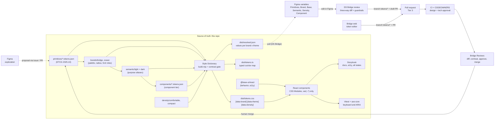

# Architecture

## Pipeline



Plain-text version:

```
primitives --> brands (palette roles) --> semantic light/dark --> component tier
                                                   density --/
all of it --> Style Dictionary (build.mjs) --> tokens.css + tokens.ts + resolved.json, fails on contrast
@base-ui/react (behavior) + tokens.css (look) --> @bridge-ds/react components --> Storybook, Vitest

tokens JSON (main) --pull (DS Bridge)--> Figma variables (Primitives, Brand, Base, Semantic, Density, Component)
Figma variables --DS Bridge: three-way diff + guardrails--> branch tokens/* + draft PR
PR --> CI guardrails + CODEOWNERS (design + tech) --> human merge --> main
```

## Token tiers

| Tier | Files | Example | Who reads it |
| ---- | ----- | ------- | ------------ |
| 1. Primitive | `src/primitives/*.tokens.json` | `color.orange.500`, `space.4`, `radius.lg`, `duration.150` | Brands and semantic tokens only. Components use primitives directly only for space and type scale steps. |
| Brand mapping | `src/brands/<brand>.tokens.json` | `palette.accent.500 -> {color.orange.500}`, `radius.control -> {radius.md}` | Semantic tokens. A brand re-points palette roles (neutral, primary, accent, success, warning, danger, info, link), radius roles and font roles. |
| 2. Semantic | `src/semantic/{light,dark}.tokens.json`, `src/semantic/base.tokens.json` | `color.text.muted`, `color.border.strong`, `focus.ring.color`, `elevation.overlay`, `motion.duration.fast`, `layer.modal` | Components, for anything that carries meaning or changes with theme. |
| 3. Component | `src/components/*.tokens.json` | `button.primary.bg -> {color.action.primary.bg}`, `table.row.bg-selected`, `dialog.radius` | One component (or one family). Added only where a component needs a stable, documented hook. |
| Density | `src/density/{comfortable,compact}.tokens.json` | `control.height.md` 40px / 32px, `table.row-height` | Components sizing controls, rows and insets. |

Rules: semantic tokens only reference `palette.*` (never a raw ramp), so a new brand needs no semantic edits.
A brand may override a handful of semantic decisions per theme in `src/brands/<brand>.<theme>.tokens.json`
(ocean uses a filled sea-blue primary instead of ink). Component tokens only alias semantic tokens.

### Themes, brands and density at runtime

```html
<html data-theme="dark" data-brand="ocean" data-density="compact">
```

| Attribute | Values | Default (`:root`) |
| --------- | ------ | ----------------- |
| `data-theme` | `light`, `dark` | `light` |
| `data-brand` | `bridge`, `ocean` | `bridge` |
| `data-density` | `comfortable`, `compact` | `comfortable` |

- Set all three on the **same element** (the root, or a nested scope). A custom property that references
  another one resolves where it is declared, so a nested scope must re-declare the semantic layer: the
  React `ThemeProvider` always renders all three attributes together.
- Portaled overlays (dialogs, menus, toasts) read the nearest `ThemeProvider` and re-apply its attributes
  on their popup (`useScopeAttributes`), so a dark section's menu is dark too.
- `prefers-reduced-motion: reduce` collapses every `motion.duration.*` to 0ms in `tokens.css` (spinners slow
  down instead of stopping).

### Contrast gate

`src/contrast.checks.json` lists 55 foreground/background pairs with a minimum ratio. The build resolves
them for every brand x theme (220 checks today) and exits non-zero on any failure, before CSS ships.
`dist/resolved.json` keeps the ratios for the docs site and the Figma plugin.

## Behavior layer: Base UI

Components wrap [Base UI](https://base-ui.com) (`@base-ui/react`, pinned at 1.9.0, by the team behind
Radix, Material UI and Floating UI). Base UI owns behavior and accessibility: focus management, keyboard
interaction, ARIA, positioning, dismissal, form validation. We own the API and the look.

- Our components expose a stable, smaller API (`variant`, `size`, `label`, `error`...) and keep Base UI an
  implementation detail. Swapping or upgrading Base UI should not change our props.
- Styling hooks are Base UI's data attributes (`[data-checked]`, `[data-highlighted]`,
  `[data-starting-style]`...) and CSS variables (`--transform-origin`, `--anchor-width`).
- Every visual value comes from a token through `var(--*)`; Stylelint enforces it.

## Two tiers become three: what changed in v1

v0 had two tiers (primitives, semantic light/dark) and one brand. v1 adds the brand mapping layer, the
component tier, density modes, motion, layers, focus offset, icon sizes and breakpoints, and fixes
`color.border.strong` (now at least 3:1 against surfaces in every brand and theme).

## Where Figma fits

Figma is where designers explore and edit. It is not the source of truth and there is no live sync.
The bridge is DS Bridge, the plugin in `apps/figma-plugin`, built on `@bridge-ds/core` (`packages/core`,
the same token logic a CLI or an MCP server can use). Repo paths come from `bridge.config.json`.

1. **Pull** (code to Figma). The plugin reads the DTCG files on `main` through the GitHub API and writes
   them into Figma variables, one collection per tier: Primitives, Brand (modes Bridge and Ocean), Base,
   Semantic (Light and Dark), Density (Comfortable and Compact) and Component. Semantic variables alias
   Brand palette variables, component variables alias Semantic ones, so switching a frame's Brand or
   Semantic mode re-resolves everything below it. On plans limited to one mode per collection, each
   multi-mode tier gets one collection per mode (`Semantic/Light`, `Brand/Ocean`). The pulled commit is
   stored in the file as the base.
2. **Edit.** Designers change variables in Figma like any other variable.
3. **Push** (Figma to code). The plugin diffs three versions per token (base, Figma, current `main`),
   shows conflicts side by side, runs the guardrails below, and opens a draft PR from a `tokens/*`
   branch with a single commit and a changeset. Each edited value goes back to the file of its tier and
   mode (`brands/ocean.tokens.json`, `semantic/dark.tokens.json`, `density/compact.tokens.json`...).
4. **Review gates.** The PR goes through CI and CODEOWNERS like any Tier 3 change (`docs/GOVERNANCE.md`).
   A human merges it; the next pull brings Figma back in line with what shipped.

Brand theme overrides (`brands/ocean.{light,dark}.tokens.json`) have no Figma equivalent, since a
variable has one value per mode of one collection and an override depends on brand and theme at once.
They stay code-only: never written by a pull or a push, listed as a warning, and still used for
contrast. Editing a semantic token that a brand overrides warns that the edit does not reach that brand.

Contrast in the plugin uses `contrast.checks.json`, the same file as the token build, resolved for
every brand x theme. The PR shows, for each changed token, every pair whose foreground or background
resolves through it: directly, or through an alias (a palette role or a primitive that a semantic
token points to), in the brand and theme where the changed mode is used.

Why not a live two-way sync: it makes it unclear which side won a conflict, and it lets an unreviewed
canvas edit reach production. Edits flow both ways, but only through a reviewed PR, so every change has
a diff, a reviewer and a changelog. Tokens removed on `main` are flagged as orphans in Figma, never
deleted silently. Composite tokens such as shadows, durations and easings stay code-only.

## Where the AI agent fits

The agent works like any contributor: it reads `AGENTS.md`, works on an `agent/*` branch and opens a PR.
It gets context from the repo itself (token files, typed `cssVar` map, stories, lint errors) rather than a
long prose style guide. Atlassian reported that a large DESIGN.md file was less effective than structured
access (MCP, skills) combined with lint; this repo applies the cheap half of that finding: short agent
instructions plus machine-checked rules. It does not ship an MCP server.

Rules live in CI, not in prompts. A prompt can be ignored; a failing Stylelint check cannot be merged.

## Guardrails

| Check | Catches |
| ----- | ------- |
| `tokens:build` | Broken aliases, invalid DTCG values |
| `typecheck` | Prop and API mistakes in components and stories |
| `tokens:build` contrast gate | Any text, control edge or focus ring pair below its WCAG minimum, in any brand x theme |
| `lint:css` | Hex, `rgb()`, named colors, raw `box-shadow`, raw lengths (`px`, `rem`) and durations (`ms`, `s`), `cubic-bezier()`, raw z-index, font and line-height values, `!important` in component CSS |
| `test` | Keyboard and ARIA behavior of interactive components, axe-core rules (Vitest + Testing Library, jsdom) |
| `build-storybook` | Stories that do not compile or render |
| Changeset check | Package changes with no semver bump or changelog entry |
| CODEOWNERS | Token and guardrail changes without design + tech approval |
| DS Bridge (in Figma, before the PR) | Tier order (brand and density alias primitives, semantic colors alias Brand palette roles, component tokens alias semantic tokens and never a palette role or raw color), raw values where an alias is required, broken references, alias cycles, values missing in a mode of their tier, orphan brand overrides, `ALL_SCOPES` variables, type changes, pairs in `contrast.checks.json` below their minimum in any brand x theme |
| Plugin and core tests | `@bridge-ds/core` (Vitest, in `npm test`): lossless DTCG round trip, tier resolution, contrast parity with `dist/resolved.json`, diff, validators, PR body, risk tier, GitHub client. Plugin (`plugin:test`): pull/edit/push flow against an in-memory GitHub and a simulated Figma. Plus typecheck and build |
