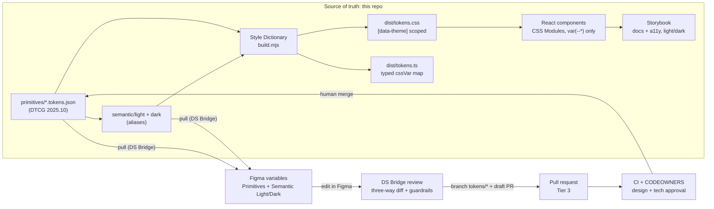

# Architecture

## Pipeline



Plain-text version:

```
primitives/*.tokens.json --+
                           +--> Style Dictionary --> tokens.css ([data-theme]) --> components --> Storybook
semantic/{light,dark}.json-+                     \-> tokens.ts (typed)

tokens JSON (main) --pull (DS Bridge)--> Figma variables (Primitives, Semantic Light/Dark)
Figma variables --DS Bridge: three-way diff + guardrails--> branch tokens/* + draft PR
PR --> CI guardrails + CODEOWNERS (design + tech) --> human merge --> main
```

## Two tiers of tokens

| Tier | Example | Who uses it |
| ---- | ------- | ----------- |
| Primitive | `color.brand.600`, `space.4`, `shadow.md` | Semantic tokens; spacing/radius/type in components |
| Semantic | `color.action.primary.bg`, `focus.ring.color`, `elevation.overlay` | Components, for anything that changes with theme or meaning |

Themes only re-point semantic aliases. Components never know which theme is active: they read
`var(--color-action-primary-bg)` and the `[data-theme]` attribute decides what it resolves to.

## Where Figma fits

Figma is where designers explore and edit. It is not the source of truth and there is no live sync.
The bridge is DS Bridge, the plugin in `apps/figma-plugin`:

1. **Pull.** The plugin reads the DTCG files on `main` through the GitHub API and writes them into Figma
   variables: a Primitives collection, and Semantic with Light and Dark modes (or one collection per
   theme on plans limited to one mode). The pulled commit is stored in the file as the base.
2. **Edit.** Designers change variables in Figma like any other variable.
3. **Review and push.** The plugin diffs three versions per token (base, Figma, current `main`), shows
   conflicts side by side, runs the guardrails (semantic tokens alias primitives, no cycles or broken
   references, no `ALL_SCOPES`, WCAG contrast on declared pairs) and opens a draft PR from a
   `tokens/*` branch with a single commit and a changeset.
4. **Review gates.** The PR goes through CI and CODEOWNERS like any Tier 3 change (`docs/GOVERNANCE.md`).
   A human merges it; the next pull brings Figma back in line with what shipped.

Why not a live two-way sync: it makes it unclear which side won a conflict, and it lets an unreviewed
canvas edit reach production. Edits flow both ways, but only through a reviewed PR, so every change has
a diff, a reviewer and a changelog. Tokens removed on `main` are flagged as orphans in Figma, never
deleted silently. Composite tokens such as shadows stay code-only.

## Where the AI agent fits

The agent works like any contributor: it reads `AGENTS.md`, works on an `agent/*` branch and opens a PR.
It gets context from the repo itself (token files, typed `cssVar` map, stories, lint errors) rather than a
long prose style guide. Atlassian reported that a large DESIGN.md file was less effective than structured
access (MCP, skills) combined with lint; this repo applies the cheap half of that finding: short agent
instructions plus machine-checked rules. It does not ship an MCP server.

Rules live in CI, not in prompts. A prompt can be ignored; a failing Stylelint check cannot be merged.

## Guardrails

| Check | Catches |
| ----- | ------- |
| `tokens:build` | Broken aliases, invalid DTCG values |
| `typecheck` | Prop and API mistakes in components and stories |
| `lint:css` | Hex, `rgb()`, `hsl()`, named colors, raw `box-shadow`, `!important` in component CSS |
| `build-storybook` | Stories that do not compile or render |
| Changeset check | Package changes with no semver bump or changelog entry |
| CODEOWNERS | Token and guardrail changes without design + tech approval |
| DS Bridge (in Figma, before the PR) | Semantic tokens not aliasing a primitive, raw values in semantic tokens, broken references, alias cycles, missing theme values, `ALL_SCOPES` variables, type changes, WCAG AA failures on `contrast-pairs.json` |
| Plugin CI job | DS Bridge typecheck, unit tests (lossless DTCG round trip, diff, resolver, WCAG, validators), build |
