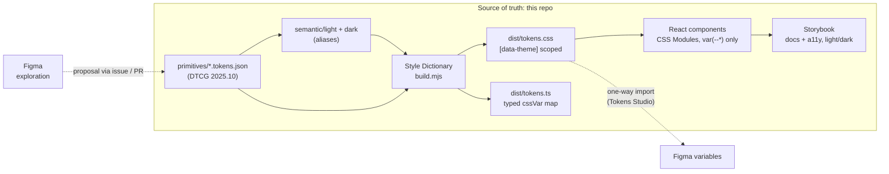

# Architecture

## Pipeline



Plain-text version:

```
primitives/*.tokens.json --+
                           +--> Style Dictionary --> tokens.css ([data-theme]) --> components --> Storybook
semantic/{light,dark}.json-+                     \-> tokens.ts (typed)

Figma (explore) ..proposal..> PR changing tokens
tokens JSON ..one-way import (Tokens Studio)..> Figma variables
```

## Two tiers of tokens

| Tier | Example | Who uses it |
| ---- | ------- | ----------- |
| Primitive | `color.brand.600`, `space.4`, `shadow.md` | Semantic tokens; spacing/radius/type in components |
| Semantic | `color.action.primary.bg`, `focus.ring.color`, `elevation.overlay` | Components, for anything that changes with theme or meaning |

Themes only re-point semantic aliases. Components never know which theme is active: they read
`var(--color-action-primary-bg)` and the `[data-theme]` attribute decides what it resolves to.

## Where Figma fits

Figma is where designers explore. It is not the source of truth and there is no bidirectional live sync.

1. A designer explores in Figma and opens an issue or PR describing the token or component change.
2. The change lands in this repo through the normal review gates (`docs/GOVERNANCE.md`).
3. After merge, tokens are imported one way into Figma variables (for example with Tokens Studio reading
   the DTCG files), so the next exploration starts from what actually shipped.

Why one way: two-way sync makes it unclear which side won a conflict, and it lets an unreviewed canvas edit
reach production. Keeping the repo authoritative means every change has a diff, a reviewer and a changelog.

## Where the AI agent fits

The agent works like any contributor: it reads `AGENTS.md`, works on an `agent/*` branch and opens a PR.
It gets context from the repo itself (token files, typed `cssVar` map, stories, lint errors) rather than a
long prose style guide. Atlassian reported that a large DESIGN.md file was less effective than structured
access (MCP, skills) combined with lint; this repo applies the cheap half of that finding: short agent
instructions plus machine-checked rules. It does not ship an MCP server.

Rules live in CI, not in prompts. A prompt can be ignored; a failing Stylelint check cannot be merged.

## Guardrails

| Check | Catches |
| ----- | ------- |
| `tokens:build` | Broken aliases, invalid DTCG values |
| `typecheck` | Prop and API mistakes in components and stories |
| `lint:css` | Hex, `rgb()`, `hsl()`, named colors, raw `box-shadow`, `!important` in component CSS |
| `build-storybook` | Stories that do not compile or render |
| Changeset check | Package changes with no semver bump or changelog entry |
| CODEOWNERS | Token and guardrail changes without design + tech approval |
